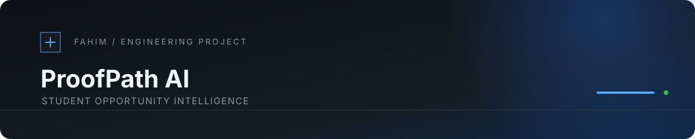

<div align="center">




[Social preview SVG source · 1280 × 640](./assets/brand/social-preview.svg)

</div>

# ProofPath AI 4.0 — Student Opportunity Intelligence, Verification & Trust Operations Platform

**Existing deployment:** The connected Render service currently tracks the repository `main` branch. This read-only candidate has not been deployed and is not the code currently served by that service.

> **Demo limitations:** Hosted on a free service without a persistent disk, so SQLite data may reset after a restart, spin-down, or redeployment. No-cost verification reports are explicitly marked `INSUFFICIENT_EVIDENCE` until independent source-grounding is available. Gemini Copilot calls are disabled by default and require an operator-confirmed free-tier project, a configured global cap, and each student's consent.

ProofPath AI is a full-stack TypeScript application for organizing opportunity records, checking eligibility against stored rules, tracking applications, and reviewing submitted URLs or text locally. In the current no-cost mode it does not independently verify opportunity claims or extract document contents.

## Read-only public demo mode

This release candidate can be built as a public, non-account demo by setting both
`DEMO_MODE=true` (server runtime) and `VITE_DEMO_MODE=true` (frontend build).
Production defaults to read-only unless an operator explicitly sets
`DEMO_MODE=false`. Production frontend builds also default to read-only unless
`VITE_DEMO_MODE=false` is explicitly supplied. The server rejects every
non-GET/HEAD/OPTIONS API request with HTTP 403 and `DEMO_READ_ONLY`, skips
session lookup, and reports `demoMode: true` from `/api/health`. The UI replaces
account and contact forms with a clear demo notice.

For a hosted preview, also set `OLLAMA_ENABLED=false`, leave OpenJarvis
unconfigured, and keep all Gemini gates false. Use an absolute ephemeral
`DB_PATH` only because the demo must not store student information; this is
not durable storage. Never use this configuration for real student records.

The connected Render service currently points to the existing `main` branch.
This candidate has **not** been deployed to that service, and no new public
service has been created by this release preparation.

## Architecture Overview

- **Frontend**: React 19, TypeScript, Tailwind CSS v4 (Warm Ivory / Deep Ink / Electric Lime editorial palette with Light & Dark modes), Lucide icons, client-side PDF export (`jspdf`).
- **Backend**: Express + TypeScript (`server.ts`, `server/app.ts`) with Zod validation, HTTP-only cookie sessions, scrypt password hashing, CSRF protection, sliding-window rate limiting, SSRF network guardrails (`server/ssrf.ts`), and magic-byte file upload validation (`multer`).
- **Database**: SQLite via `better-sqlite3` (`WAL` mode, foreign keys enforced, additive idempotent schema migrations in `server/db.ts`). The connected Render demo's filesystem is ephemeral; do not use it to store real student data.
- **JARVIS Advisor**: Private, deterministic Guided Mode uses the signed-in student's saved profile, applications, published records, and owned reports. Optional Ollama and OpenJarvis providers connect only to server-configured loopback endpoints. Gemini Free-tier requests are disabled by default, require operator configuration and student consent, and send only the current message after basic PII redaction. Google may use Free-tier prompts and responses to improve its products. Model answers are not streamed and receive no prior chat history or private profile context; deterministic record summaries are appended locally. No search grounding, URL Context, or file uploads are configured.
- **Student Pathfinder**: A six-step guide turns journey, goal, funding, country, and deadline selections into filters supported by the published opportunity API. Academic field, region, and modality preferences are labeled guidance-only because catalogue records do not store those fields.
- **Evidence review**: URL reachability and submitted text can be reviewed locally for basic risk cues. Results stay `INSUFFICIENT_EVIDENCE` until a reviewer independently checks reliable sources. Uploaded file contents are not extracted or analyzed.

## Core Modules

1. **Opportunity Intelligence Score (0–100)**: Transparent weighted scoring across Profile Completeness (30), Verified Match Coverage (30), Application Readiness (25), and Verification Hygiene (15), paired with a Personal Opportunity Radar, Deadline Intelligence (Urgent / Upcoming / Expired), and Personal Action Center.
2. **Evidence Review & Audit History**: Saved reports preserve the submitted title/URL and review limitations. Current no-cost reviews do not extract claim graphs or retrieve independent sources; comparison and PDF export can help inspect stored report data without turning it into an official verdict.
3. **Opportunity Match Intelligence & Trust Profiles**: Personalized funding fit, academic compatibility, deadline urgency, missing-attribute checks, official domain classification, linked verification counts, and community report totals on every opportunity detail page.
4. **Application Intelligence**: Kanban, List, and interactive Monthly Calendar views with real-time Readiness Checklists highlighting missing documents and incomplete steps.

## Database Setup & Models

SQLite persists to `DB_PATH` (defaults to `./data/proofpath.db` in development). Production startup requires `DB_PATH` to be explicitly set to an absolute path on a durable persistent volume; the application cannot detect whether a host path is actually durable, so validate the mount with a staging restart/restore rehearsal. Migrations run automatically on startup across the core account, application, verification, and trust-monitoring tables:
- `users`, `sessions`, `password_resets`, `student_profiles`
- `opportunities`, `verification_reports`, `evidence_records`, `saved_opportunities`
- `applications`, `application_documents`, `notifications`, `notification_preferences`
- `conversations`, `messages`, `community_reports`, `moderation_logs`
- `admin_audit_logs`, `ai_usage_logs`, `contact_messages`, `site_content`

### Development Evaluation Accounts

Demo accounts are created only when `NODE_ENV !== 'production'` and are blocked from signing in in production. The application does not seed opportunity listings or verification reports; add and review real records through the authorized workflow.
- **Student**: `student@proofpath.ai` / `Student@2026!`
- **Moderator**: `moderator@proofpath.ai` / `Moderator@2026!`
- **Admin**: `admin@proofpath.ai` / `Admin@2026!`

In production deployments, register standard accounts via `/register` or provision administrators directly on the database. New opportunities are saved as unpublished drafts and appear in the protected admin review queue. An authorized reviewer must inspect the HTTPS official source, set the record to `VERIFIED`, enter a review note of at least 10 characters, and explicitly publish it. The note is retained in the admin audit log. The API rejects publishing any record that is not `VERIFIED` and automatically unpublishes a record when its status is changed away from `VERIFIED`. This is a human-review control, not an automated independent-source verification system. Existing production rows are not changed by this guard and must be audited separately before launch.

## Environment Variables

Copy `.env.example` to `.env` and configure:
- `GEMINI_API_KEY`: Server-side Gemini API key. Never expose it to the browser.
- `AI_ENABLED`: Defaults to `false`; must be explicitly enabled before the Gemini Copilot can call Google.
- `AI_FREE_TIER_CONFIRMED`: Defaults to `false`; only set `true` after checking that the API key belongs to a Free-tier project in AI Studio.
- `AI_STUDENT_AUDIENCE_APPROVED`: Defaults to `false`; the server will not call Gemini unless an operator has reviewed and confirmed audience compatibility with Google's current terms. ProofPath is student-facing and may be accessed by minors; an age checkbox or user consent alone is not sufficient.
- `AI_MODEL`: Allowlisted model, currently `gemini-4-hydrogen`.
- `AI_DAILY_REQUEST_LIMIT`: Per-user daily cap; defaults to 10.
- `AI_GLOBAL_DAILY_LIMIT`: Required project-wide daily cap; defaults to 0 (Gemini remains disabled). Set no higher than the active Free-tier quota shown for the project in AI Studio.
- `AI_MAX_OUTPUT_TOKENS`, `AI_MAX_INPUT_LENGTH`, `AI_MAX_CONCURRENT_REQUESTS`: Compact output/input and bounded concurrency controls.
- `OLLAMA_BASE_URL`, `OLLAMA_MODEL`: Optional loopback Ollama endpoint and model. The application defaults to `http://127.0.0.1:11434` and `qwen3.5:2b`.
- `OPENJARVIS_BASE_URL`, `OPENJARVIS_MODEL`, `OPENJARVIS_API_KEY`: Optional OpenJarvis OpenAI-compatible API endpoint, model, and server-side key. Only loopback URLs are accepted.
- `APP_URL`: Public URL of the deployed service.
- `SESSION_SECRET`: Random high-entropy string for HMAC session token hashing.
- `DB_PATH`: Development may use `./data/proofpath.db`; production requires an absolute path on durable storage (e.g., `/var/data/proofpath/proofpath.db`).

For production, set `NODE_ENV=production`, use a unique `SESSION_SECRET` with at least 32 characters, set `APP_URL` to the deployed HTTPS origin, and set `DB_PATH` to an explicit absolute path on durable persistent storage. The server fails at startup when the production session secret is missing or too short, or when `DB_PATH` is missing or not absolute. The application cannot determine whether a valid absolute path is backed by a persistent host volume. Generate the session secret with `openssl rand -hex 32`; never commit it or reuse the example value from `.env.example`.

Before upgrading an existing database, inspect legacy public records with `SELECT id, title, verification_status FROM opportunities WHERE is_published = 1 AND verification_status <> 'VERIFIED';`. The new API prevents future publication of non-VERIFIED items but does not silently rewrite existing production rows. Back up first, then unpublish/re-review any such legacy entries through the authorized admin workflow.

### Local AI provider setup

Local providers run on the same machine as the ProofPath backend. The URL checks reject non-loopback hosts, and provider settings belong in the backend environment only. A hosted ProofPath server's `127.0.0.1` is the hosted server, not a student's Mac; the public website cannot reach a student's local Ollama service. Keep Ollama and OpenJarvis bound to `127.0.0.1` and do not tunnel or expose these ports publicly.

Ollama is available when the configured model appears in `ollama list` and its local API responds on port 11434. For OpenJarvis, the installed CLI exposes an OpenAI-compatible `jarvis serve` command; one local-only example is `jarvis serve --host 127.0.0.1 --port 8000 --engine ollama --model qwen3.5:2b`, followed by `OPENJARVIS_BASE_URL=http://127.0.0.1:8000` and the matching `OPENJARVIS_MODEL`. Verify the installed OpenJarvis configuration and model with `jarvis doctor` before relying on it. The assistant uses direct model inference only; its model does not receive unrestricted agent tools.

## Local Development, Testing & Deployment

```bash
npm install
npm run dev      # Starts Express + Vite middleware on port 3000
npm run lint     # TypeScript typecheck
npm test         # Runs Vitest integration & security suite
npm run audit    # Fails on high/critical npm advisories
npm run build    # Builds Vite production bundle to dist/
npm start        # Serves production API + static dist/ via tsx server.ts
```

The in-memory rate limiter is a single-process safeguard only. Keep one application instance with the current SQLite setup; before horizontal scaling or running multiple workers, move rate limiting to a shared atomic store.

## Security Controls

- **Authentication**: `crypto.scryptSync` salted password hashing + `crypto.timingSafeEqual` verification, HTTP-only `SameSite=Lax` cookies, and per-session `X-CSRF-Token` validation on state-changing requests. Demo evaluation accounts are disabled in production (`NODE_ENV === 'production'`).
- **AI privacy and quotas**: The Gemini Copilot is disabled by default. With explicit site and student opt-in, only the current message (after basic PII redaction) is sent; profile data, prior chats, reports, and files stay local. It uses no Search grounding, URL Context, or paid fallback. Per-user and global daily counters plus concurrency leases persist in SQLite. Read [`docs/AI_PRIVACY_AND_HOSTING.md`](./docs/AI_PRIVACY_AND_HOSTING.md) before enabling it.
- **SSRF Protection**: Rejects `localhost`, loopback, link-local, cloud metadata (`169.254.169.254`), and private IPv4/IPv6 CIDR ranges before fetching external URLs.
- **Pinned URL fetches**: Resolves every host and redirect, rejects restricted results, pins the request to the validated address to prevent DNS rebinding, and caps fetched text at 120 KB with a seven-second timeout.
- **Production browser headers**: Enables a restrictive Content Security Policy and HSTS in production; CSRF token comparisons use constant-time equality.
- **Upload Validation**: File uploads are limited to 10 MB with a MIME allowlist (`PDF`, `PNG`, `JPEG`, `WEBP`) and binary magic-byte checks. Validation confirms only type and size; file contents are not analyzed in no-cost mode.
- **Role-Based Access Control**: Server-side `requireRole('admin', 'moderator')` enforcement on all administrative and moderation endpoints with persistent `admin_audit_logs`.


## ProofPath AI 4.0 — Trust Intelligence

See [`docs/PRODUCT_RESEARCH.md`](./docs/PRODUCT_RESEARCH.md) for the product research, design rationale, reference-site inspection limits, and scope of this transformation pass.

The trust layer adds the following capabilities:

- **Evidence source signals:** Legacy evidence links can be inspected for URL-level signals based on HTTPS and alignment with the opportunity's listed host. This is not a domain reputation check and never proves ownership, accreditation, or legitimacy. New no-cost reviews do not retrieve independent sources.
- **Opportunity change history:** A scheduled checker stores a text snapshot of public opportunity pages and records content-hash changes. A changed page is a review signal; the system does not infer that a deadline or funding term changed without a human checking the page.
- **Saved opportunity watchlists:** Students can configure in-app deadline reminders and page-change notifications for opportunities they have saved.
- **Community safety patterns:** Administrators and moderators can review report volume, distinct reporters, reason diversity, and moderation state by host. These metrics prioritize review and do not establish fraud.
- **Explainable eligibility:** The API returns criterion-level rules, missing profile fields, completeness, and next steps. Missing information is not scored as a pass.
- **Trust & Safety analytics:** A role-protected operational view summarizes published listings, monitored changes, reports, saved listings, and evidence links.
- **Verification comparison:** Authenticated users can compare 2–4 reports they are authorized to view, including repeated claim text and conflicting verdicts.
- **Bilingual advisor:** Guided Mode gives English/Bengali next steps from stored application records. Optional Gemini requests have a separate privacy disclosure and quota gate; its reply does not receive the saved profile or report context.

### Scheduled monitoring setup

The workflow in `.github/workflows/opportunity-monitor.yml` is a GitHub Actions scheduler that runs every six hours and can also be started manually. It calls the authenticated internal endpoint on the Render service.

1. Generate a random secret with at least 32 characters.
2. Add it in GitHub: **Repository → Settings → Secrets and variables → Actions → New repository secret**, named `MONITORING_CRON_SECRET`.
3. Add the same value in Render: **proofpath-ai-demo → Environment**, also named `MONITORING_CRON_SECRET`.
4. Deploy the branch after review and merge, then use **Actions → Opportunity monitoring → Run workflow** to test it.

The endpoint rejects requests when the secret is missing or invalid. The workflow does not print the secret to its logs.

### Deployment and persistence limitations

The connected Render service is currently on the Free plan and uses the application's SQLite file under `./data`. A free service without a persistent disk can lose local database contents during restarts or redeployments. The monitoring code and scheduler do not remove that platform limitation. For dependable long-term watchlists and change history, configure persistent storage or migrate the application's primary database before treating scheduled history as durable.

In-app notifications are supported. Outbound email and push delivery are not enabled in this release; no email address is contacted by the monitor. GitHub Actions requires the repository secret above, and the Render service requires the matching environment variable. No paid Render resources are provisioned by this change.
